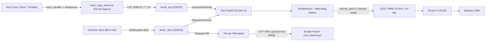

# Rover IHS — ESP32-CAM & Linux Kernel Driver

<div align="center">


</div>

> **Summary (EN):** 2WD Rover controlled via **Xbox BLE HID** and a custom **Linux Kernel Module (`rover_input_driver`)** over TCP. The ESP32-CAM firmware runs **FreeRTOS** task/queue arbitration, an **Xtensa Assembly** PWM routine (`calculo_pwm.S`), H-bridge deadtime/watchdog protection, and real-time binary HID telemetry over TCP for Python diagnostics.

Projeto da disciplina de Interface Hardware/Software (**UFS**) para controlar um rover 2WD com **ESP32-CAM**, ponte H **L9110S**, controle Xbox via **BLE**, controle alternativo via **TCP** a partir de um **módulo de kernel Linux** e telemetria HID em tempo real pela rede.

---

## 🏗️ Arquitetura do Sistema



Mesmo com duas fontes de comando (BLE direto e TCP vindo do módulo de kernel Linux), os motores são controlados por uma única task FreeRTOS (`TaskMotores`), evitando condições de corrida nos GPIOs.

---

## 📁 Estrutura do Repositório

```text
├── esp32_firmware/          # Firmware da ESP32-CAM (PlatformIO + FreeRTOS + Xtensa ASM)
│   ├── include/
│   ├── src/
│   └── platformio.ini
├── linux_kernel_module/     # Módulo de kernel Linux (rover_input_driver.c + Makefile)
└── hid_telemetry/           # Scripts Python de telemetria e análise HID
```

### Componentes Principais

| Módulo / Arquivo | Função |
| :--- | :--- |
| [`esp32_firmware/src/main.cpp`](esp32_firmware/src/main.cpp) | Inicializa fila FreeRTOS, motores, Wi-Fi/TCP e task BLE. |
| [`esp32_firmware/src/driver_motores.cpp`](esp32_firmware/src/driver_motores.cpp) | Controla a ponte H L9110S, PWM, watchdog (`500 ms`) e arbitragem. |
| [`esp32_firmware/src/driver_tcp.cpp`](esp32_firmware/src/driver_tcp.cpp) | Mantém Wi-Fi, servidor de comandos (`:8080`) e telemetria (`:8081`). |
| [`esp32_firmware/src/driver_xbox.cpp`](esp32_firmware/src/driver_xbox.cpp) | Conecta ao controle Xbox via BLE/HID e interpreta notificações. |
| [`esp32_firmware/src/calculo_pwm.S`](esp32_firmware/src/calculo_pwm.S) | Rotina em **Assembly Xtensa** que converte duty cycle (`0..255` → `0..1020`). |
| [`esp32_firmware/include/wifi_secrets.example.h`](esp32_firmware/include/wifi_secrets.example.h) | Modelo para credenciais locais de Wi-Fi/BLE fora do Git. |
| [`linux_kernel_module/rover_input_driver.c`](linux_kernel_module/rover_input_driver.c) | Driver Linux (`input_handler` + `workqueue` + TCP socket em kernel space). |
| [`linux_kernel_module/Makefile`](linux_kernel_module/Makefile) | Compila, carrega, remove e monitora o módulo no kernel Linux. |
| [`hid_telemetry/protocolo_telemetria.py`](hid_telemetry/protocolo_telemetria.py) | Parser do protocolo binário de telemetria TCP. |
| [`hid_telemetry/demonstracaoTCP.py`](hid_telemetry/demonstracaoTCP.py) | Visualizador de reports HID em tempo real. |
| [`hid_telemetry/xbox_sniff.py`](hid_telemetry/xbox_sniff.py) | Gravador de payloads HID recebidos pela rede. |
| [`hid_telemetry/analisar_dump.py`](hid_telemetry/analisar_dump.py) | Analisador de diferenças entre dumps HID salvos. |

---

## ⚙️ Detalhes Técnicos

### 1. Firmware ESP32 & Controle dos Motores
- **RTOS:** Fila de comandos com tamanho 1 (`xQueueOverwrite`) armazenando apenas o estado mais recente (`F`, `T`, `P`), evitando execução atrasada de comandos antigos.
- **Ponte H L9110S & LEDC PWM:** 4 canais LEDC em `20 kHz` e resolução de `10 bits`, com cálculo de duty cycle em **Assembly Xtensa** (`calcularPWM`).
- **Segurança & Watchdog:** inicialização em repouso, parada física + *deadtime* de `500 us` antes de reverter direção, watchdog de `500 ms` e prioridade máxima para comando de parada (`P`).

| Sinal | GPIO |
| :--- | :--- |
| Motor 1 frente / trás | `13` / `14` |
| Motor 2 frente / trás | `4` / `15` |

### 2. BLE HID & Protocolo TCP
- **BLE (`driver_xbox.cpp`):** assina notificações da característica HID do controle Xbox (`X` = Frente, `Y` = Trás, `B` = Parar) e copia payloads para a fila de telemetria sem bloquear a pilha Bluetooth.
- **TCP Porta `8080`:** comandos `F` (Frente), `T` (Trás), `P` (Parar).
- **TCP Porta `8081`:** frames binários `[uint16 big-endian tamanho][payload HID bruto]`.

### 3. Módulo de Kernel Linux (`rover_input_driver`)
Registra um `input_handler` para capturar eventos de controles Xbox ou teclados e usa uma `workqueue` para enviar heartbeats TCP em kernel space fora do contexto atômico de interrupção/input (`X`/↑ = Frente, `Y`/↓ = Trás, `A`/`B`/Espaço = Parar).

---

## 🚀 Como Compilar e Executar

### 1. Configurar credenciais locais (Wi-Fi / MAC BLE)
```bash
cp esp32_firmware/include/wifi_secrets.example.h esp32_firmware/include/wifi_secrets.h
```

### 2. Firmware ESP32-CAM (PlatformIO)
```bash
cd esp32_firmware
pio run
pio run --target upload
pio device monitor -b 115200
```

### 3. Módulo de Kernel Linux
Requer headers do kernel instalados (`sudo apt install build-essential linux-headers-$(uname -r) bluez`):

```bash
make -C linux_kernel_module check
make -C linux_kernel_module all
make -C linux_kernel_module load ESP_IP=<IP_DA_ESP32> ESP_PORT=8080 HEARTBEAT_MS=100
make -C linux_kernel_module status
make -C linux_kernel_module log
make -C linux_kernel_module unload
```

<details>
<summary><b>Todos os alvos e parâmetros do Makefile</b></summary>

| Alvo / Parâmetro | Descrição |
| :--- | :--- |
| `check` / `all` / `clean` | Verifica dependências, compila `rover_input_driver.ko` e limpa artefatos. |
| `load` / `unload` / `reload` | Carrega, remove ou recompila e recarrega o módulo no kernel. |
| `status` / `log` / `dmesg-full` | Exibe estado em `lsmod`, dispositivos de entrada, conexões TCP e logs. |
| `bt-pair` / `bt-status` | Auxilia pareamento e status do controle Xbox via `bluetoothctl`. |
| `ESP_IP`, `ESP_PORT`, `HEARTBEAT_MS` | IP da ESP32, porta (`8080`) e intervalo de heartbeat (`100 ms`). |

</details>

### 4. Telemetria e Análise HID (Python)
```bash
python hid_telemetry/demonstracaoTCP.py <IP_DA_ESP32>
python hid_telemetry/demonstracaoTCP.py <IP_DA_ESP32> --todos
python hid_telemetry/xbox_sniff.py <IP_DA_ESP32> --arquivo hid_telemetry/captura_xbox.txt
python hid_telemetry/analisar_dump.py hid_telemetry/xbox_dump.txt --detalhado
```

---

## ⚠️ Segurança de Bancada
- Teste primeiro com as rodas suspensas fora do chão.
- Tenha um corte físico de bateria e nunca alimente motores pelo pino 3,3 V da ESP32.
- Mantenha GND comum entre ESP32 e ponte H L9110S.
