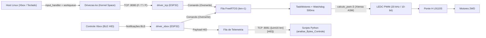

# Rover IHS com ESP32


> **Summary (EN):** 2WD Rover controlled via **Xbox BLE HID** and a custom **Linux Kernel Module (`Drivezao`)** over TCP. The ESP32-CAM firmware runs **FreeRTOS** task/queue arbitration, an **Xtensa Assembly** PWM routine (`calculo_pwm.S`), H-bridge deadtime/watchdog protection, and real-time binary HID telemetry over TCP for Python diagnostics.

Projeto da disciplina de Interface Hardware/Software para controlar um rover 2WD com ESP32-CAM, ponte H L9110S, controle Xbox via BLE, controle alternativo via TCP a partir de um módulo de kernel Linux e telemetria HID pela rede.

O sistema foi desenvolvido em três partes:

- **Firmware da ESP32 (`esp32_firmware/`):** responsável por FreeRTOS, BLE HID, Wi-Fi/TCP, telemetria e controle de motores;
- **Módulo de Kernel Linux (`linux_kernel_module/Drivezao.c`):** driver em kernel space que lê eventos de entrada (`input_handler`) e envia comandos TCP via `workqueue` para a ESP32;
- **Scripts Python (`analise_Bytes_Controle/`):** captura, visualização e análise dos reports HID do controle.

## Estrutura do Repositório

```text
esp32_firmware/          Firmware da ESP32-CAM (PlatformIO + Arduino/FreeRTOS + Xtensa ASM)
linux_kernel_module/     Módulo de kernel Linux (Drivezao.c + Makefile)
analise_Bytes_Controle/  Scripts Python de telemetria e análise HID
```

Arquivos principais:

| Arquivo | Função |
| :--- | :--- |
| `esp32_firmware/src/main.cpp` | Inicializa fila FreeRTOS, motores, Wi-Fi/TCP e task BLE. |
| `esp32_firmware/src/driver_motores.cpp` | Controla a ponte H L9110S, PWM, watchdog (500 ms) e arbitragem. |
| `esp32_firmware/src/driver_tcp.cpp` | Mantém Wi-Fi, servidor de comandos (`8080`) e servidor de telemetria (`8081`). |
| `esp32_firmware/src/driver_xbox.cpp` | Conecta ao controle Xbox via BLE/HID e interpreta botões. |
| `esp32_firmware/src/calculo_pwm.S` | Rotina em **Assembly Xtensa** para converter duty cycle (`0..255` → `0..1020`). |
| `esp32_firmware/include/wifi_config.h` | Carrega credenciais locais sem expor senha no repositório. |
| `esp32_firmware/include/wifi_secrets.example.h` | Modelo para criar o arquivo local de Wi-Fi. |
| `linux_kernel_module/Drivezao.c` | Driver Linux (`input_handler` + `workqueue` + TCP socket) para o rover. |
| `linux_kernel_module/Makefile` | Compila, carrega, remove e monitora o módulo Linux. |
| `analise_Bytes_Controle/protocolo_telemetria.py` | Implementa o leitor do protocolo de telemetria TCP. |
| `analise_Bytes_Controle/demonstracaoTCP.py` | Mostra os reports HID recebidos em tempo real. |
| `analise_Bytes_Controle/xbox_sniff.py` | Grava payloads HID recebidos pela telemetria. |
| `analise_Bytes_Controle/analisar_dump.py` | Analisa diferenças entre dumps HID salvos. |

## Arquitetura



Mesmo com duas fontes de comando (BLE direto e TCP vindo do módulo de kernel Linux), os motores são controlados por uma única task FreeRTOS (`TaskMotores`), evitando condições de corrida nos GPIOs.

## Como Foi Feito

### Firmware ESP32

O firmware usa Arduino para ESP32 e FreeRTOS. A inicialização principal cria uma fila de comandos com uma posição (`xQueueOverwrite`), configura os motores, inicia a rede, sobe os servidores TCP e cria a task responsável pelo controle Xbox BLE.

A fila de comandos guarda sempre o estado mais recente (`F`, `T` ou `P`) para evitar que comandos antigos sejam executados com atraso.

### Controle dos Motores

A ponte H usada é uma **L9110S**. Pinagem atual no firmware:

| Sinal | GPIO |
| :--- | :--- |
| Motor 1 frente | `13` |
| Motor 1 trás | `14` |
| Motor 2 frente | `4` |
| Motor 2 trás | `15` |

O PWM usa quatro canais LEDC, frequência de `20 kHz` e resolução de `10 bits`. A rotina `calcularPWM`, escrita em **Assembly Xtensa**, converte entrada `0..255` para `0..1020`.

Recursos de segurança implementados:
- Inicialização sempre em repouso;
- Parada física antes de inverter direção;
- Tempo morto (*deadtime*) de `500 us` durante reversão;
- Watchdog de `500 ms` para parar os motores se o heartbeat cessar;
- Prioridade máxima para qualquer comando de parada;
- Arbitragem entre comandos BLE e TCP.

### Controle Xbox por BLE

O firmware conecta ao controle Xbox via serviço HID BLE, localiza a característica de *input report* com notificação, registra o callback e interpreta os bytes recebidos:

| Botão | Ação |
| :--- | :--- |
| `X` | Frente |
| `Y` | Trás |
| `B` | Parar |

Os reports HID são copiados para uma fila de telemetria sem bloquear a pilha Bluetooth.

### TCP

A ESP32 expõe duas portas TCP:

| Porta | Uso | Formato |
| :--- | :--- | :--- |
| `8080` | Comandos de movimento | `F` (Frente), `T` (Trás), `P` (Parar) |
| `8081` | Telemetria HID | `[uint16 big-endian tamanho][payload HID bruto]` |

### Módulo de Kernel Linux (`Drivezao`)

O `Drivezao` é um módulo de kernel Linux em C que registra um `input_handler`, detecta controles Xbox ou teclados compatíveis e envia comandos TCP em kernel space via `workqueue` (mantendo o callback de input não-bloqueante). Enquanto o comando está pressionado, envia heartbeats periódicos; ao soltar, envia `P` imediatamente.

| Entrada | Ação |
| :--- | :--- |
| Xbox `X` ou Seta ↑ | Frente |
| Xbox `Y` ou Seta ↓ | Trás |
| Xbox `A`, `B` ou Espaço | Parar |

## Configuração de Wi-Fi e Controle

```bash
cp esp32_firmware/include/wifi_secrets.example.h esp32_firmware/include/wifi_secrets.h
```

Preencha em `esp32_firmware/include/wifi_secrets.h` (ignorado pelo `.gitignore`):

```c
#define ROVER_WIFI_SSID "nome-da-rede"
#define ROVER_WIFI_PASSWORD "senha-da-rede"
#define MAC_XBOX "aa:bb:cc:dd:ee:ff" // opcional
```

## Compilação e Upload

### 1. Firmware ESP32-CAM (PlatformIO)

```bash
cd esp32_firmware
pio run
pio run --target upload
pio device monitor -b 115200
```

### 2. Módulo de Kernel Linux (`Drivezao.ko`)

Requer ambiente Linux com headers do kernel instalados:

```bash
sudo apt install build-essential linux-headers-$(uname -r) bluez
```

Principais comandos via `linux_kernel_module/Makefile`:

```bash
make -C linux_kernel_module check
make -C linux_kernel_module all
make -C linux_kernel_module load ESP_IP=<IP_DA_ESP32> ESP_PORT=8080 HEARTBEAT_MS=100
make -C linux_kernel_module status
make -C linux_kernel_module log
make -C linux_kernel_module unload
make -C linux_kernel_module clean
```

<details>
<summary><b>Tabela completa de alvos e parâmetros do Makefile</b></summary>

| Alvo | Função |
| :--- | :--- |
| `check` | Verifica headers, compilador, Bluetooth e estado do módulo. |
| `all` | Compila `Drivezao.ko`. |
| `load` | Compila e carrega o módulo no kernel. |
| `unload` | Remove o módulo do kernel. |
| `reload` | Remove, limpa, recompila e carrega novamente. |
| `status` | Mostra módulo, entradas detectadas, logs e conexão TCP. |
| `log` / `watch` | Mostra logs filtrados do Drivezao em tempo real. |
| `dmesg-full` | Mostra `dmesg` completo em tempo real. |
| `bt-pair` | Abre fluxo de pareamento Bluetooth via `bluetoothctl`. |
| `bt-status` | Mostra status do controle Xbox no Linux. |
| `clean` | Remove artefatos de compilação. |

| Parâmetro | Padrão | Descrição |
| :--- | :--- | :--- |
| `ESP_IP` | `192.168.100.65` | IP da ESP32. |
| `ESP_PORT` | `8080` | Porta TCP de comandos. |
| `HEARTBEAT_MS` | `100` | Intervalo entre comandos mantidos. |

</details>

## Telemetria e Análise HID

```bash
# Visualizar reports HID em tempo real
python analise_Bytes_Controle/demonstracaoTCP.py <IP_DA_ESP32>
python analise_Bytes_Controle/demonstracaoTCP.py <IP_DA_ESP32> --todos

# Capturar payloads e analisar dumps
python analise_Bytes_Controle/xbox_sniff.py <IP_DA_ESP32> --arquivo analise_Bytes_Controle/captura_xbox.txt
python analise_Bytes_Controle/analisar_dump.py analise_Bytes_Controle/xbox_dump.txt --detalhado
```

## Sequência Recomendada de Teste e Segurança de Bancada

1. Configurar `wifi_secrets.h` e gravar o firmware na ESP32-CAM (`pio run --target upload`).
2. Anotar o IP exibido no monitor serial (`115200 baud`) e validar a telemetria com `demonstracaoTCP.py`.
3. Compilar e carregar `Drivezao.ko` apontando para `ESP_IP=<IP_DA_ESP32>`.
4. **Segurança:** teste primeiro com as rodas fora do chão, tenha um corte físico de bateria, não alimente motores pelo 3,3 V da ESP32, mantenha GND comum entre ESP32 e ponte H e confirme a polaridade antes de colocar no chão.
